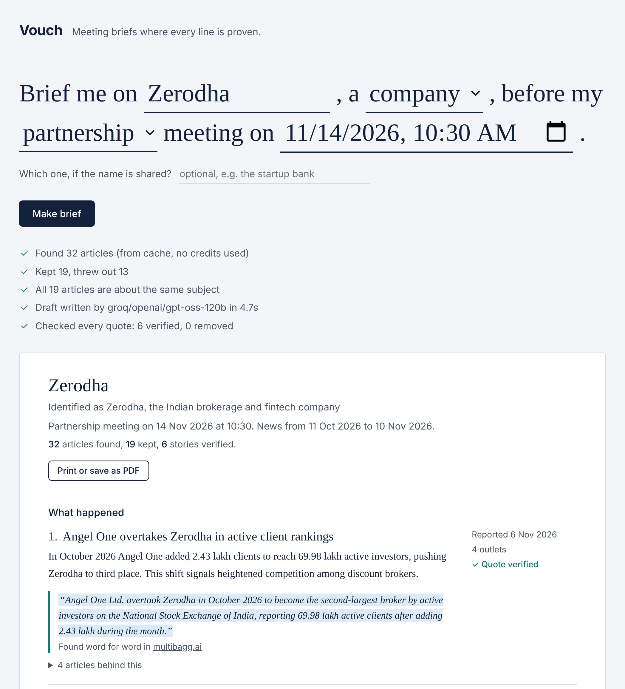
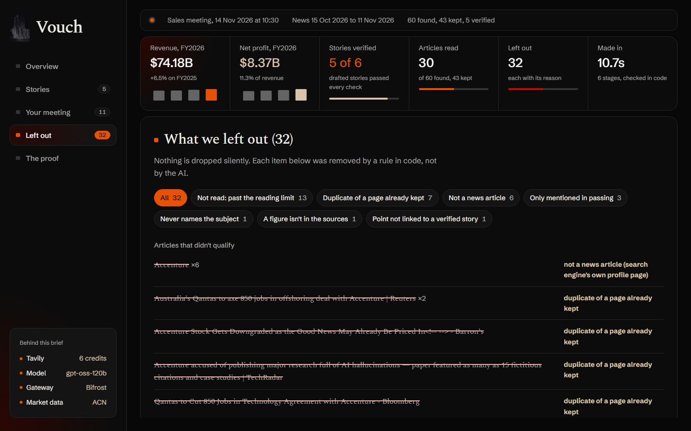
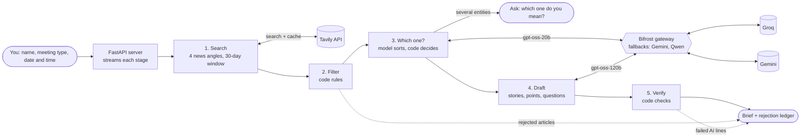

# Vouch

**Meeting briefs where every line is proven.**

Give Vouch a company or person and a meeting date. It reads the news from the 30 days before the meeting, writes a one-page brief (what happened, what to raise, what to ask), and then **checks the brief in code**. A story only stays if its quote is found word for word in a real article. Everything Vouch throws out is listed with the reason, so nothing is dropped silently.

Built for the Geek Room Global AI Hackathon 2026, problem statement **Tavily Research Agent**, using **Tavily** for live research and **Bifrost by Maxim AI** as the model gateway.



## Why it exists

AI research tools write confident summaries, and the reader has no quick way to tell which lines are real. Before a meeting that matters, a wrong "fact" is worse than no fact. Vouch treats the model as a writer, not a judge: the model drafts, and plain code decides what survives.

## What makes it different

**AI writes the draft, code checks the facts, and you see everything that got rejected.**

- **Checked by code, not by another AI.** Most tools ask a model to check a model. In Vouch, plain Python decides: a quote must appear word for word in the article, every figure must appear in the sources, and the quote must share content with the claim. The model cannot argue its way past a string match.
- **Nothing is dropped silently.** Every rejected article and every AI-written line that failed a check is shown, struck through, with the reason.
- **Asks instead of guessing.** When a name could mean several companies ("Mercury"), Vouch stops and asks which one, instead of blending them into one wrong brief.
- **Measured, not claimed.** Across 4 runs, 424 of 424 deliberately corrupted stories were caught, and 9 of 104 AI-written stories (9%) were removed because they couldn't be backed up, before a reader saw them ([Results](#results)).

## What it does

| Step | Who does it | What happens |
|---|---|---|
| 1. Search | Tavily | Four targeted news searches (news, launches, people moves, deals) over the 30 days preceding the meeting (ending today if the meeting is still ahead, since later news doesn't exist yet). Results are cached so reruns cost no credits. |
| 2. Filter | Code | Drops non-news pages, duplicates, undated or out-of-window articles, and articles that don't name the subject in the headline. |
| 3. Which one? | Model sorts, code decides | The model groups articles by real-world entity. If one entity has 75%+ of articles it is kept; otherwise Vouch stops and asks the user which one they mean (it found 7 different "Mercury"s in one search). |
| 4. Draft | Model, via Bifrost | Groups articles into stories and writes talking points and questions for the meeting type (investor, sales, partnership, hiring, general). It must cite article numbers and copy one exact supporting quote per story. |
| 5. Verify | Code | Removes a story if its quote isn't found word for word in the cited article, if any figure in it doesn't appear in its sources, or if the quote shares nothing with the claim. Dates and outlet counts are computed in code. Stories whose quote dates the event before the window are flagged as older events. |

While Vouch works, an analysis screen shows each stage live as it finishes, with its real counts and who did it (Tavily, code, or the model through Bifrost). The finished brief then opens as its own page at `/brief/<id>`, a link that reopens it later without new API calls. The brief has:

- a numbers panel drawn from the brief's own data: articles kept and filtered out, stories verified and removed by checks, single-source and multi-source stories, and when each story was reported;
- each story with its quote, the site it was found in, and its flags (quote verified, single source, older event), each shown as a mark plus words, never colour alone;
- **"What we left out"**: every rejected article and every AI-written line that failed a check, struck through, with the reason;
- a closing line naming the model that wrote it through Bifrost, its tokens and time, and the Tavily credits used;
- a "Print or save as PDF" button that gives a light, one-page brief.



## Architecture



Steps 2, 3 (the decision) and 5 are plain Python you can read in `vouch/filters.py`, `vouch/entity.py` and `vouch/verify.py`. The model's output never reaches the page without passing through them.

## How Tavily is used

- `search` with `topic="news"`, `search_depth="basic"` (1 credit), `start_date`/`end_date` set to the exact 30-day window, 8 results per search.
- Tavily's `published_date` and article text are the only evidence the brief may use. Quotes are verified against that text.
- When the user says which entity they mean, the hint is added to every query (`Mercury (the startup bank) news`), which pulls in the right company far more often.
- A SQLite cache (`data/vouch.db`, 24-hour expiry) means identical searches are never paid for twice.

## How Bifrost is used

- Every model call (entity sorting and drafting) goes to the local Bifrost gateway at `http://localhost:8080/v1`. Vouch's code never holds a provider key; Bifrost does.
- Two right-sized models: `groq/openai/gpt-oss-120b` writes the brief and the smaller `groq/openai/gpt-oss-20b` sorts articles by entity. On Groq's free tier each model has its own rate limit, so splitting the work avoids most 429s.
- Every request lists fallbacks (`gemini/gemini-3.5-flash-lite`, then `groq/qwen/qwen3.8-27b`). When the requested model fails or is rate-limited, Bifrost retries on the next one by itself. The page shows which model actually wrote the brief, read from `extra_fields.routing_info`.
- **Governance.** Vouch calls Bifrost with its own virtual key (`x-bf-vk`), and Bifrost enforces Vouch's limits: 300 requests and 300,000 tokens a day, and a $1 daily budget priced at list rates. A runaway loop can't drain the free quotas. Tested: a second demo key capped at 2 requests a minute returned 200, 200, then 429 (`scripts/check_governance.py limit`); a made-up key is refused with 401.
- **Cost per brief, measured by Bifrost.** Bifrost prices every call at the provider's list rate. One brief is 2 model calls, about 7,700 tokens, and about **$0.0016** at list price (free on the free tiers used here). `GET /api/gateway` returns today's requests, tokens and spend for Vouch's key.
- Bifrost is configured from a plain `bifrost/config.json` that refers to keys by environment variable name, so it is safe to commit. `scripts/start_bifrost.py` creates Vouch's virtual key and a dashboard login in `.env` on first run.

## Reliability and safety

A backend audit found 12 weak spots; each is fixed and has a test in `tests/`.

| Risk | What Vouch does |
|---|---|
| A search result carries a `javascript:` or `data:` link | Only http(s) addresses are kept or sent to the page; all web text is inserted as text, never HTML |
| More articles pass the filters than the model reads | The extras are listed in the ledger as "not read", so nothing is dropped silently |
| The model returns ids as text, odd shapes or a cut-off reply | Replies are read defensively (`vouch/shapes.py`); a cut-off reply is reported, not guessed at |
| A quote stitched from a headline's end and the text's start | Headline and text are checked separately |
| The model's own words trigger an "older event" flag | Only the quote, which is evidence, is checked |
| One Tavily search fails, or the entity check fails | The other searches run (in parallel); the brief continues and shows a warning |
| A meeting date like year 0001 | Refused with a plain message instead of crashing the server |
| A slow model keeps the page waiting | 45 s per request, one retry; Bifrost switches models on failure |
| The page is closed mid-brief | Work stops at the next step and the server is free immediately |
| Two briefs at once double the spend | One brief at a time; the second is told to wait |
| Errors | Recognised by type (bad key, no credits, timeout, gateway down) with a fix for each |

Every finished brief is saved (`data/vouch.db`) and has its own link, so it can be reopened later without new API calls.

## Results

Measured on 10 Nov 2026 with `eval/run_eval.py` on 7 subjects, four runs. Expectations (which names are ambiguous) were written in `eval/subjects.json` **before** the first run. The code changed between runs (each fix is described below), so every run is kept: [run 1](eval/RESULTS-run1.md), [run 2](eval/RESULTS-run2.md), [run 3](eval/RESULTS-run3.md), [run 4, current code](eval/RESULTS.md).

| Measure | Run 1 | Run 2 | Run 3 | Run 4 | Total |
|---|---|---|---|---|---|
| Tamper test: verified stories corrupted on purpose and re-checked | 123 of 123 caught | 84 of 84 | 116 of 116 | 101 of 101 | **424 of 424** |
| AI-written stories removed by the code checks | 4 of 32 | 1 of 20 | 1 of 27 | 3 of 25 | **9 of 104 (9%)** |
| Ambiguous names handled as expected | 6 of 7 | 6 of 7 | 6 of 7 | 6 of 7 | Same miss each time (below) |
| Time per brief | 11 to 63 s | 3 to 14 s | 2 to 38 s | 3 to 31 s | |
| Errors | 0 | 0 | 0 | 0 | **0 of 28 briefs** |

The tamper test changes one thing at a time in a story that passed: a figure in the quote, the quote's word order, the article it cites, an invented figure in the summary, or a wholly invented quote. "AI-written stories removed" counts claims the model drafted that could not be backed up; a reader would otherwise have taken them as fact.

**The miss.** "Apollo" was expected to need a choice, but Apollo Global Management dominated the news, so Vouch kept it and set aside the articles about other Apollos (5 to 9 per run) instead of asking.

**What changed between runs.**
- Run 1 to 2: both model calls went to the same Groq model, whose free tier limits tokens per minute per model, so requests waited on HTTP 429s. The simple entity-sorting job moved to the smaller `gpt-oss-20b` (its own limit), and reasoning models were asked for low effort. A draft went from about 7,500 to 5,700 tokens and 10 s to 4 s.
- Run 3 to 4: checked against the official problem statement. The 30-day window now starts 30 days before the *meeting* (it had started 30 days before today, letting a few older days in); "business development" became a meeting type; each story is labelled single-source or with its outlet count, with a key explaining verified, single-source and older-event; and the backend audit fixes (see Reliability and safety) went in.
- Run 2 to 3: the entity step sometimes grouped articles by topic, so "Angel One overtakes Zerodha" was set aside as "a different Zerodha". Its instructions now ask *which* entity an article refers to, at temperature 0; articles it forgets to assign are kept when only one entity exists. The figure check now reads number words ("one in 10" matches "1 in 10").

**Bifrost in practice.** By runs 2 and 3, a day of testing had used up much of Groq's free allowance. Bifrost moved those briefs to Gemini, and in runs 3 and 4 to the second fallback (`qwen3.8-27b` on Groq), with no errors and no code change. A model we tried (`llama-3.1-8b-instant`) had been retired by Groq; every call to it fell back and still returned correct results. The cost is quality: Gemini drafted fewer stories (2 to 4 per brief instead of up to 6), and rate-limit waits explain the 30 to 38 s worst cases.

**What these numbers do not show.** The subjects are well-covered companies and one person, one brief each per run. The tamper test uses corruptions we designed, so it proves the checks work as specified, not that they catch every kind of mistake. Nobody has hand-graded whether each summary's interpretation is right.

## Run it yourself (Windows)

Requirements: Python 3.12+, Node.js LTS (for Bifrost), and three free API keys: [Tavily](https://tavily.com), [Groq](https://console.groq.com), [Google AI Studio](https://aistudio.google.com). None need a card.

```powershell
git clone <this repo> vouch
cd vouch
python -m venv .venv
.\.venv\Scripts\python.exe -m pip install -r requirements.txt
.\.venv\Scripts\python.exe scripts\set_keys.py        # paste the three keys (hidden), saved to .env
.\.venv\Scripts\python.exe scripts\check_services.py  # one small real call to each service
```

Terminal 1, the gateway (first start downloads Bifrost once, about 140 MB):

```powershell
.\.venv\Scripts\python.exe scripts\start_bifrost.py
```

Terminal 2, check the gateway and its fallback, then start Vouch:

```powershell
.\.venv\Scripts\python.exe scripts\check_bifrost.py
.\.venv\Scripts\python.exe scripts\check_governance.py      # limits, usage, and a refused fake key
.\.venv\Scripts\python.exe -m uvicorn app.main:app --port 8000
```

Open http://localhost:8000. On macOS or Linux, use `.venv/bin/python` instead of `.\.venv\Scripts\python.exe`.

Other commands:

```powershell
.\.venv\Scripts\python.exe -m unittest                                   # offline tests, no credits (6 need Node; skipped without it)
.\.venv\Scripts\python.exe scripts\try_brief.py "Zerodha" company 2026-11-14 partnership
.\.venv\Scripts\python.exe eval\run_eval.py                              # the measurements above
```

## Project layout

```
vouch/research.py   step 1: Tavily searches + window
vouch/cache.py      SQLite cache for search responses
vouch/filters.py    step 2: filter rules and rejection reasons
vouch/entity.py     step 3: which-one decision
vouch/llm.py        all model calls, through Bifrost, with fallback and time limits
vouch/shapes.py     reads the model's JSON defensively (odd shapes never crash a brief)
vouch/store.py      saved briefs, reopened by id without new API calls
vouch/gateway.py    reads Vouch's usage, limits and spend from Bifrost governance
vouch/draft.py      step 4: the drafting prompt
vouch/verify.py     step 5: quote, figure and relevance checks
vouch/pipeline.py   runs the steps and reports each stage
app/                FastAPI server (streams stages) and the web page (app/static: search, analysis, brief)
app/static/stats.js the brief's numbers, worked out from its own data (tested under Node)
tests/              94 offline tests: logic, pipeline, server (fake Tavily and Bifrost) and the brief's numbers
eval/               evaluation subjects, tamper test, results
bifrost/config.json gateway configuration
```

## How it would scale

Today Vouch is a single-user app: one brief at a time, on one machine. Here is what changes for a team or a product, and what already holds:

- **Cost per brief is small and known.** About 4 Tavily credits for a new subject (0 when the search is cached) and 2 model calls, about 7,700 tokens or $0.0016 at list price, as measured by Bifrost.
- **Limits per team without code changes.** Each team or customer gets its own Bifrost virtual key with its own budget and rate limits; Vouch only sends a different key. Usage per key is already readable through `GET /api/gateway`.
- **More briefs at once.** The one-at-a-time lock becomes a job queue with several workers. Each brief is an independent run of the pipeline; the only shared state is the search cache and the saved briefs.
- **Storage.** SQLite becomes Postgres for the cache and saved briefs, with the same two tables.
- **Shared search cache.** Popular companies are searched once a day for everyone, so Tavily cost grows with the number of distinct subjects, not the number of users.
- **More model providers.** A provider is added in `bifrost/config.json` and its model name added to the fallback list in `vouch/llm.py`; the pipeline itself does not change.

## Limitations

- **Quotes prove existence, not meaning.** The checks prove a quote is real, its figures appear in the sources, and it shares content with the claim. They cannot prove a summary's interpretation is right. Each story shows its quote and sources so a reader can judge.
- **Snippets, not full articles.** Verification uses the text Tavily returns for each result, not the whole page.
- **Headline rule is strict.** Requiring the subject's name in the headline sometimes drops a real article (for example "Infosys Chairman calls job fears hogwash" doesn't name him). Every such drop is shown in the ledger.
- **News coverage decides quality.** Small private companies with little coverage get short briefs, and Vouch says so rather than padding.
- **Saved briefs are local.** A brief's link (`/brief/<id>`) opens only on the computer that made it, because briefs are stored in a local SQLite file.
- **Free tiers.** Tavily's free plan is 1,000 credits a month (about 4 per new brief). Groq and Gemini free tiers rate-limit; Bifrost's fallback covers short outages, not a full day's limit.

## License

MIT
