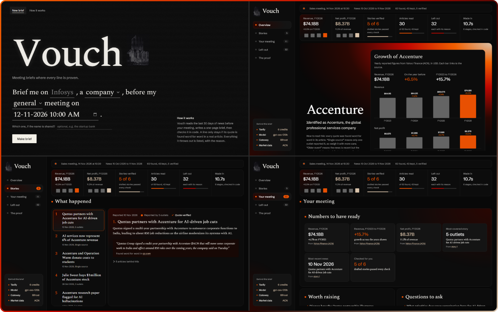
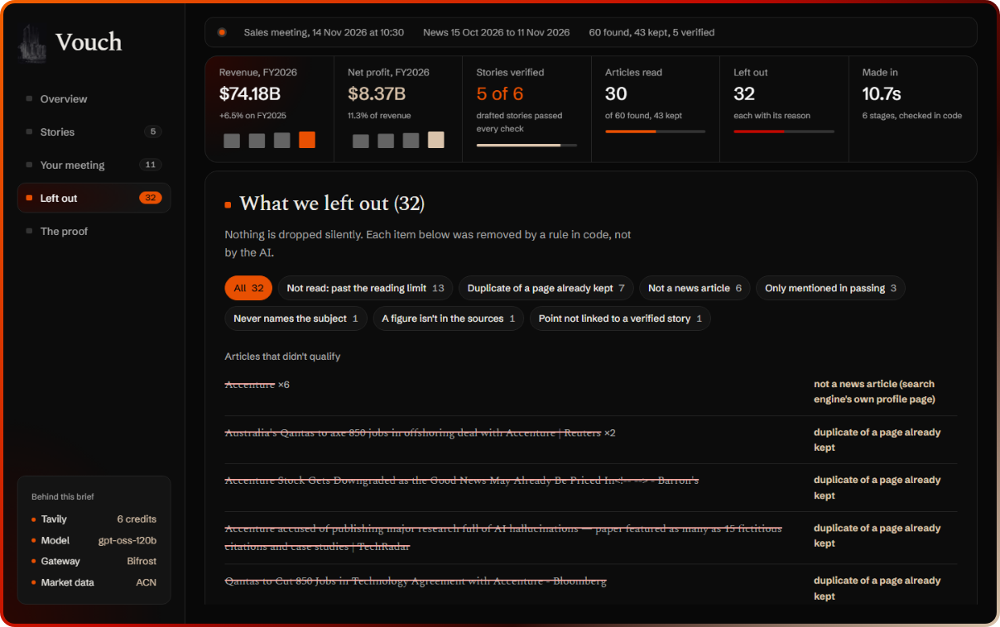

<p align="center">
  
</p>

<h1 align="center">Vouch</h1>

<p align="center">
  <b>Meeting briefs where every line is proven.</b><br>
  AI writes the draft. Code checks the facts.
</p>

<p align="center">
  <a href="#how-it-works">How it works</a> ·
  <a href="#run-it-yourself-macos-linux-or-windows">Run it</a> ·
  <a href="#how-ai-is-used">How AI is used</a> ·
  <a href="#results">Results</a> ·
  <a href="#limitations">Honest limits</a>
</p>

<p align="center">
  
  
  
  
  
  
  
  
</p>

---


Vouch prepares you for a meeting with a company or a person. Give it a name, the kind of meeting and the date. It reads the news from the 30 days before the meeting, writes a brief (what happened, the numbers to have ready, what to raise and what to ask), and then **checks the brief in code**. A story only stays if its quote is found word for word in a real article and every figure in it appears in the sources. Everything Vouch throws out is listed with the reason, so nothing is dropped silently.

Built for the **Geek Room Global AI Hackathon 2026**, problem statement **Tavily Research Agent**, using **Tavily** for live research and **Bifrost by Maxim AI** as the model gateway.



## Contents

- [Why it exists](#why-it-exists)
- [What makes it different](#what-makes-it-different)
- [How it works](#how-it-works)
- [The brief](#the-brief)
- [Architecture](#architecture)
- [How AI is used](#how-ai-is-used)
- [How Tavily is used](#how-tavily-is-used)
- [How Bifrost is used](#how-bifrost-is-used)
- [Reliability and safety](#reliability-and-safety)
- [Results](#results)
- [Run it yourself](#run-it-yourself-macos-linux-or-windows)
- [Run with Docker](#run-with-docker)
- [Configuration](#configuration)
- [Project layout](#project-layout)
- [How it would scale](#how-it-would-scale)
- [Limitations](#limitations)
- [License](#license)

## Why it exists

AI research tools write confident summaries, and the reader has no quick way to tell which lines are real. Before a meeting that matters, a wrong "fact" is worse than no fact. Vouch treats the model as a writer, not a judge: the model drafts, and plain code decides what survives.

## What makes it different

**AI writes the draft, code checks the facts, and you see everything that got rejected.**

- **Checked by code, not by another AI.** Most tools ask a model to check a model. In Vouch, plain Python decides: a quote must appear word for word in the article, every figure must appear in the sources, and the quote must share content with the claim. The model cannot argue its way past a string match.
- **Nothing is dropped silently.** Every rejected article and every AI-written line that failed a check is shown, struck through, with the reason.
- **Asks instead of guessing.** When a name could mean several companies ("Mercury"), Vouch stops and asks which one, instead of blending them into one wrong brief.
- **Numbers you can stand behind.** Revenue and profit come from Yahoo Finance for listed companies, or from news sentences that code finds word for word; every figure links to its source.
- **Measured, not claimed.** Across 4 evaluation runs, 424 of 424 deliberately corrupted stories were caught, and 9 of 104 AI-written stories (9%) were removed because they couldn't be backed up, before a reader saw them ([Results](#results)).

## How it works

| Step | Who does it | What happens |
|---|---|---|
| 1. Search | Tavily | Six targeted news searches for a company (news, launches, people moves, deals, results, strategy) or four for a person, up to 20 results each, over the 30 days before the meeting (ending today if the meeting is still ahead, since later news doesn't exist yet). Results are cached, so reruns cost no credits. |
| 2. Filter | Code | Drops non-news pages, duplicates, undated or out-of-window articles, and articles that don't name the subject in the headline. Names match however they are spelled (JP Morgan, JPMorgan, J.P. Morgan), always as whole words. |
| 3. Which one? | Model sorts, code decides | The model groups articles by real-world entity. If one entity has 75% or more of the articles it is kept; otherwise Vouch stops and asks which one you mean (it once found 7 different "Mercury"s in one search). |
| 4. Draft | Model, via Bifrost | Reads the 30 newest articles, groups them into up to 10 stories (one per distinct event) and writes 6 to 8 talking points and 6 to 8 questions for the meeting type (sales, investor, partnership, business development, hiring, general). It must cite article numbers and copy one exact supporting quote per story. |
| 5. Verify | Code | Removes a story if its quote isn't found word for word in the cited article, if any figure in it doesn't appear in its sources, or if the quote shares nothing with the claim. Removes talking points and questions that aren't linked to a surviving story. Dates and outlet counts are computed in code; stories whose quote dates the event before the window are flagged as older events. |
| 6. Growth | Market data, or news checked in code | Yearly revenue and net profit. A listed company's figures come from Yahoo Finance. Otherwise one more Tavily search looks for annual results, a small model points at candidate figures, and code keeps a figure only if its sentence is found word for word in the article and holds that number and year. A person gets their company's growth, if the articles name it. |

## The brief

While Vouch works, an analysis screen shows each stage live as it finishes, with its real counts and who did it (Tavily, code, or the model through Bifrost). The finished brief opens as its own page at `/brief/<id>`, a link that reopens it later without new API calls.

The brief is a one-screen workspace: a sidebar of sections, a status line, key figures (revenue, net profit, stories verified, articles read, left out, time taken), and the open section:

| Section | What it shows |
|---|---|
| **Overview** | The subject, how it was identified, and the growth graph: revenue and net profit by year, each bar linked to its source. |
| **Stories** | The verified stories, each with its quote, the site it was found in, and its flags (quote verified, single source, older event), shown as a mark plus words, never colour alone. |
| **Your meeting** | Numbers to have ready (revenue, growth, margin, the most-covered and the latest story, all from checked figures), then what to raise and what to ask, each linked to its story. |
| **Left out** | Every rejected article and every AI-written line that failed a check, struck through, with the reason, filterable by reason. |
| **The proof** | Every stage with its real counts, why things were left out, which model wrote the brief through Bifrost, its tokens and time, and the Tavily credits used. |

The browser's Print gives a light, one-page version of the brief with every section.



## Architecture

The animated diagram at the top of this page shows one brief moving through Vouch. One FastAPI server runs the six stages and streams each one to the page as it finishes (Server-Sent Events). The page is plain HTML, CSS and JavaScript with no build step. Steps 2, 3 (the decision) and 5 are plain Python you can read in `vouch/filters.py`, `vouch/entity.py` and `vouch/verify.py`. The model's output never reaches the page without passing through them.

## How AI is used

AI is used in exactly three places, always through the Bifrost gateway, and never to decide what is true.

| Where | Model | What the model does | What code does with it |
|---|---|---|---|
| Step 3, which one? | `groq/openai/gpt-oss-20b` | Says which real-world entity each article is about. | Counts the groups and decides: keep the main entity or ask you. |
| Step 4, draft | `groq/openai/gpt-oss-120b` | Groups articles into stories and writes headlines, summaries, talking points and questions, citing article numbers and copying one quote per story. | Checks every quote, figure and link; computes dates and outlet counts; removes whatever fails. |
| Step 6, growth from news (unlisted companies only) | `groq/openai/gpt-oss-20b` | Points at sentences that may hold yearly revenue or profit. | Keeps a figure only if the sentence is in the article word for word and holds that number and year. |

If a model is down or rate-limited, Bifrost retries the same request on `gemini/gemini-3.5-flash-lite`, then `groq/qwen/qwen3.8-27b`. The brief shows which model actually wrote it.

**The model never** chooses which articles are kept, computes a date, count or growth rate, or sees an API key. Its only inputs are the subject, the meeting details and the article text Tavily returned.

**API keys.** Vouch uses three external keys, all from free tiers that need no card, plus keys that Bifrost creates for itself:

| Key | Service | Used by | How it is set |
|---|---|---|---|
| `TAVILY_API_KEY` | Tavily search | Vouch (steps 1 and 6) | `scripts/set_keys.py` |
| `GROQ_API_KEY` | Groq models (gpt-oss, Qwen) | Bifrost only | `scripts/set_keys.py` |
| `GEMINI_API_KEY` | Google AI Studio (Gemini fallback) | Bifrost only | `scripts/set_keys.py` |
| `VOUCH_VK` | Vouch's Bifrost virtual key | Vouch, on every model call | Created by `scripts/make_keys.py` (run for you by `scripts/start_bifrost.py`) |
| `VOUCH_DEMO_VK` | A second, tightly limited virtual key | `scripts/check_governance.py` | Created by `scripts/make_keys.py` (run for you by `scripts/start_bifrost.py`) |
| `BIFROST_ADMIN_USERNAME`, `BIFROST_ADMIN_PASSWORD` | Bifrost dashboard login | Usage readout (`/api/gateway`) | Created by `scripts/make_keys.py` (run for you by `scripts/start_bifrost.py`) |

All keys live in `.env`, which git ignores (`.env.example` lists them with empty values). `scripts/set_keys.py` reads them with hidden input. Vouch's application code never holds a model provider key: it only sends its virtual key to Bifrost, and Bifrost holds the Groq and Gemini keys. `bifrost/config.json` refers to keys by environment variable name only, so it is safe to commit. Yahoo Finance needs no key.

## How Tavily is used

- `search` with `topic="news"`, `search_depth="basic"` (1 credit each), `start_date`/`end_date` set to the exact 30-day window, and up to 20 results per search (still 1 credit).
- A new company costs 6 credits (a person 4), plus 1 for an unlisted company, whose growth figures come from a search for its annual results. A cached search costs nothing.
- Tavily's `published_date` and article text are the only evidence the brief may use. Quotes are verified against that text.
- When you say which entity you mean, the hint is added to every query (`Mercury (the startup bank) news`), which pulls in the right company far more often.
- A SQLite cache (`data/vouch.db`, 24-hour expiry) means identical searches are never paid for twice.

## How Bifrost is used

- Every model call goes to the local Bifrost gateway at `http://localhost:8080/v1`, through the OpenAI-compatible API.
- **Right-sized models.** `gpt-oss-120b` writes the brief and the smaller `gpt-oss-20b` sorts articles by entity. On Groq's free tier each model has its own rate limit, so splitting the work avoids most HTTP 429s.
- **Automatic fallbacks.** Every request lists its fallbacks. When the requested model fails or is rate-limited, Bifrost retries on the next one by itself. The page shows which model actually answered, read from `extra_fields.routing_info`.
- **Governance.** Vouch calls Bifrost with its own virtual key (`x-bf-vk`), and Bifrost enforces Vouch's limits: 1,000 requests and 1,000,000 tokens a day, and a $1 daily budget priced at list rates, so a runaway loop can't drain the free quotas. Tested: a second demo key capped at 2 requests a minute returned 200, 200, then 429 (`scripts/check_governance.py limit`); a made-up key is refused with 401.
- **Cost per brief, measured by Bifrost.** A brief is 2 model calls (3 when growth comes from news). A measured Accenture brief used about 9,700 tokens (6,237 to draft, 3,467 to sort entities), which is a fraction of a cent at list price and free on the free tiers used here. `GET /api/gateway` returns today's requests, tokens and spend for Vouch's key.
- `scripts/start_bifrost.py` downloads Bifrost on first run and creates Vouch's virtual keys and a dashboard login in `.env`.

## Reliability and safety

A backend audit found 12 weak spots; each is fixed and has a test in `tests/`.

| Risk | What Vouch does |
|---|---|
| A search result carries a `javascript:` or `data:` link | Only http(s) addresses are kept or sent to the page; all web text is inserted as text, never HTML |
| More articles pass the filters than the model reads | The extras are listed in the ledger as "not read", so nothing is dropped silently |
| The model returns ids as text, odd shapes or a cut-off reply | Replies are read defensively (`vouch/shapes.py`); a cut-off reply is reported, not guessed at |
| A quote stitched from a headline's end and the text's start | Headline and text are checked separately |
| The model's own words trigger an "older event" flag | Only the quote, which is evidence, is checked |
| One Tavily search fails, or the entity check fails | The other searches run (in parallel); the brief continues and shows a warning |
| A meeting date like year 0001 | Refused with a plain message instead of crashing the server |
| A slow model keeps the page waiting | 45 s per request, one retry; Bifrost switches models on failure |
| The page is closed mid-brief | Work stops at the next step and the server is free immediately |
| Two briefs at once double the spend | One brief at a time; the second is told to wait |
| Errors | Recognised by type (bad key, no credits, timeout, gateway down) with a fix for each |

Every finished brief is saved (`data/vouch.db`) and has its own link, so it can be reopened later without new API calls.

## Results

Measured on 10 Nov 2026 with `eval/run_eval.py` on 7 subjects, four runs. Expectations (which names are ambiguous) were written in `eval/subjects.json` **before** the first run. The code changed between runs (each fix is described below), so every run is kept: [run 1](eval/RESULTS-run1.md), [run 2](eval/RESULTS-run2.md), [run 3](eval/RESULTS-run3.md), [run 4](eval/RESULTS.md). These runs used the earlier research limits (4 searches of 8 results, 20 articles read, up to 6 stories); the checks themselves are unchanged.

| Measure | Run 1 | Run 2 | Run 3 | Run 4 | Total |
|---|---|---|---|---|---|
| Tamper test: verified stories corrupted on purpose and re-checked | 123 of 123 caught | 84 of 84 | 116 of 116 | 101 of 101 | **424 of 424** |
| AI-written stories removed by the code checks | 4 of 32 | 1 of 20 | 1 of 27 | 3 of 25 | **9 of 104 (9%)** |
| Ambiguous names handled as expected | 6 of 7 | 6 of 7 | 6 of 7 | 6 of 7 | Same miss each time (below) |
| Time per brief | 11 to 63 s | 3 to 14 s | 2 to 38 s | 3 to 31 s | |
| Errors | 0 | 0 | 0 | 0 | **0 of 28 briefs** |

The tamper test changes one thing at a time in a story that passed: a figure in the quote, the quote's word order, the article it cites, an invented figure in the summary, or a wholly invented quote. "AI-written stories removed" counts claims the model drafted that could not be backed up; a reader would otherwise have taken them as fact.

**The miss.** "Apollo" was expected to need a choice, but Apollo Global Management dominated the news, so Vouch kept it and set aside the articles about other Apollos (5 to 9 per run) instead of asking.

**What changed between runs.**
- Run 1 to 2: both model calls went to the same Groq model, whose free tier limits tokens per minute per model, so requests waited on HTTP 429s. The simple entity-sorting job moved to the smaller `gpt-oss-20b` (its own limit), and reasoning models were asked for low effort. A draft went from about 7,500 to 5,700 tokens and 10 s to 4 s.
- Run 2 to 3: the entity step sometimes grouped articles by topic, so "Angel One overtakes Zerodha" was set aside as "a different Zerodha". Its instructions now ask *which* entity an article refers to, at temperature 0; articles it forgets to assign are kept when only one entity exists. The figure check now reads number words ("one in 10" matches "1 in 10").
- Run 3 to 4: checked against the official problem statement. The 30-day window now starts 30 days before the *meeting* (it had started 30 days before today, letting a few older days in); "business development" became a meeting type; each story is labelled single-source or with its outlet count; and the backend audit fixes (see [Reliability and safety](#reliability-and-safety)) went in.

**After run 4.** A study of saved briefs showed the research limits, not the checks, kept briefs short, and that "JP Morgan" lost 23 of 32 articles to a spelling mismatch. The limits were raised (6 searches of 20 results, 30 articles read, up to 10 stories) and names now match across spellings. A measured Accenture brief now finds 60 articles, where 32 was the old maximum.

**Bifrost in practice.** By runs 2 and 3, a day of testing had used up much of Groq's free allowance. Bifrost moved those briefs to Gemini, and in runs 3 and 4 to the second fallback (`qwen3.8-27b` on Groq), with no errors and no code change. A model we tried (`llama-3.1-8b-instant`) had been retired by Groq; every call to it fell back and still returned correct results. The cost is quality: Gemini drafted fewer stories (2 to 4 per brief instead of up to 6), and rate-limit waits explain the 30 to 38 s worst cases.

**What these numbers do not show.** The subjects are well-covered companies and one person, one brief each per run. The tamper test uses corruptions we designed, so it proves the checks work as specified, not that they catch every kind of mistake. Nobody has hand-graded whether each summary's interpretation is right.

## Run it yourself (macOS, Linux or Windows)

**Requirements:** Python 3.12+, Node.js LTS (for Bifrost), and three free API keys: [Tavily](https://tavily.com), [Groq](https://console.groq.com) and [Google AI Studio](https://aistudio.google.com). None need a card.

**1. Get the code and a virtual environment.** Only this step differs by system.

macOS or Linux (Terminal):

```bash
git clone https://github.com/ussr07/vouch.git
cd vouch
python3 -m venv .venv
source .venv/bin/activate
```

Windows (PowerShell):

```powershell
git clone https://github.com/ussr07/vouch.git
cd vouch
python -m venv .venv
.\.venv\Scripts\Activate.ps1
```

If PowerShell refuses to run `Activate.ps1`, run `Set-ExecutionPolicy -Scope Process Bypass` once in that window and try again.

**2. Install and add your keys.** Everything from here is the same on every system, typed in a terminal where the environment is active (the prompt starts with `(.venv)`). Every new terminal needs the activate line from step 1 first.

```bash
python -m pip install -r requirements.txt
python scripts/set_keys.py        # paste the three keys (hidden), saved to .env
python scripts/check_services.py  # one small real call to each service
```

**3. Start the gateway** in terminal 1 (the first start downloads Bifrost once, about 140 MB):

```bash
python scripts/start_bifrost.py
```

**4. Check the gateway, then start Vouch** in terminal 2:

```bash
python scripts/check_bifrost.py
python scripts/check_governance.py      # limits, usage, and a refused fake key
python -m uvicorn app.main:app --port 8000
```

Open http://localhost:8000.

**Tests and tools:**

```bash
python -m unittest                                         # 125 offline tests, no credits (10 need Node; skipped without it)
python scripts/try_brief.py "Zerodha" company 2026-11-14 partnership
python eval/run_eval.py                                    # the measurements above
```

The tests run offline against fake Tavily and Bifrost responses, so they cost nothing and need no keys.

## Run with Docker

Docker runs Vouch and the Bifrost gateway together, with nothing to install but Docker (Docker Desktop on macOS and Windows, Docker Engine with the Compose plugin on Linux).

**1. Add your keys.** Copy the example file and paste your Tavily, Groq and Gemini keys after the `=` signs:

```bash
git clone https://github.com/ussr07/vouch.git
cd vouch
cp .env.example .env              # Windows PowerShell: Copy-Item .env.example .env
```

**2. Create Vouch's Bifrost keys** (its virtual keys and the dashboard login). This adds them to `.env` once and never changes a key that is already set:

```bash
docker compose run --rm --no-deps vouch python scripts/make_keys.py
```

**3. Start both services:**

```bash
docker compose up --build
```

Open http://localhost:8000 for Vouch. The Bifrost gateway and its dashboard are on http://localhost:8080 (sign in with `BIFROST_ADMIN_USERNAME` and `BIFROST_ADMIN_PASSWORD` from `.env`). Saved briefs and the search cache are kept in `./data`, and Bifrost reads `./bifrost/config.json`, so both survive a restart. Stop with `Ctrl+C`, or `docker compose down`.

The Vouch container reaches the gateway at `http://bifrost:8080` (set in `docker-compose.yml`); the gateway holds the Groq and Gemini keys, exactly as in the local setup.

## Configuration

Optional environment variables (in `.env` or the shell). The defaults are what the results above were measured with.

| Variable | Default | Purpose |
|---|---|---|
| `VOUCH_PRIMARY_MODEL` | `groq/openai/gpt-oss-120b` | Model that drafts the brief |
| `VOUCH_ENTITY_MODEL` | `groq/openai/gpt-oss-20b` | Model that sorts articles by entity and reads growth figures |
| `VOUCH_FALLBACK_MODELS` | `gemini/gemini-3.5-flash-lite,groq/qwen/qwen3.8-27b` | Fallbacks Bifrost tries, in order |
| `BIFROST_URL` | `http://localhost:8080/v1` | Bifrost's OpenAI-compatible address |
| `VOUCH_GROWTH` | `1` | Set to `0` to skip the growth step |

## Project layout

```
vouch/research.py   step 1: Tavily searches and the 30-day window
vouch/cache.py      SQLite cache for search responses
vouch/filters.py    step 2: filter rules, name matching and rejection reasons
vouch/entity.py     step 3: which-one decision
vouch/draft.py      step 4: the drafting prompt
vouch/verify.py     step 5: quote, figure and relevance checks
vouch/growth.py     step 6: yearly revenue and profit, from market data or checked news
vouch/pipeline.py   runs the steps and reports each stage
vouch/llm.py        all model calls, through Bifrost, with fallbacks and time limits
vouch/shapes.py     reads the model's JSON defensively (odd shapes never crash a brief)
vouch/store.py      saved briefs, reopened by id without new API calls
vouch/gateway.py    reads Vouch's usage, limits and spend from Bifrost governance
app/                FastAPI server (streams stages) and the web page (app/static: search, analysis, brief)
app/static/stats.js the brief's numbers, worked out from its own data (tested under Node)
tests/              125 offline tests: logic, pipeline, growth, server, key setup and the brief's numbers
eval/               evaluation subjects, tamper test and results
scripts/            key setup, service checks, Bifrost start-up and one-off tryouts
bifrost/config.json gateway configuration
Dockerfile          the Vouch image (Python 3.12, FastAPI server and page)
docker-compose.yml  Vouch and Bifrost together, one command
docs/               screenshots and the architecture diagram
```

## How it would scale

Today Vouch is a single-user app: one brief at a time, on one machine. Here is what changes for a team or a product, and what already holds:

- **Cost per brief is small and known.** 6 Tavily credits for a new company (0 when the search is cached) and 2 model calls of about 9,700 tokens, metered by Bifrost.
- **Limits per team without code changes.** Each team or customer gets its own Bifrost virtual key with its own budget and rate limits; Vouch only sends a different key. Usage per key is already readable through `GET /api/gateway`.
- **More briefs at once.** The one-at-a-time lock becomes a job queue with several workers. Each brief is an independent run of the pipeline; the only shared state is the search cache and the saved briefs.
- **Storage.** SQLite becomes Postgres for the cache and saved briefs, with the same two tables.
- **Shared search cache.** Popular companies are searched once a day for everyone, so Tavily cost grows with the number of distinct subjects, not the number of users.
- **More model providers.** A provider is added in `bifrost/config.json` and its model name added to the fallback list; the pipeline itself does not change.

## Limitations

- **Quotes prove existence, not meaning.** The checks prove a quote is real, its figures appear in the sources, and it shares content with the claim. They cannot prove a summary's interpretation is right. Each story shows its quote and sources so a reader can judge.
- **Snippets, not full articles.** Verification uses the text Tavily returns for each result, not the whole page.
- **Headline rule is strict.** Requiring the subject's name in the headline sometimes drops a real article (for example "Infosys Chairman calls job fears hogwash" doesn't name him). Every such drop is shown in the ledger.
- **News coverage decides quality.** Small private companies with little coverage get short briefs, and Vouch says so rather than padding. The model also tends to write fewer stories than the limit allows.
- **Saved briefs are local.** A brief's link (`/brief/<id>`) opens only on the computer that made it, because briefs are stored in a local SQLite file.
- **Free tiers.** Tavily's free plan is 1,000 credits a month (about 6 per new company brief). Groq and Gemini free tiers rate-limit; Bifrost's fallbacks cover short outages, not a full day's limit.

## License

[MIT](LICENSE) © 2026 Nishanth Reddy
